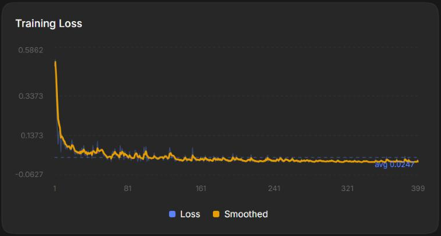
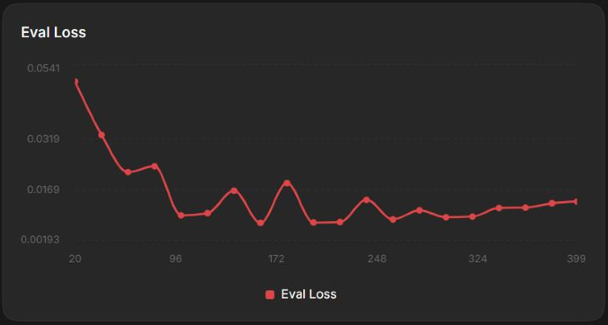

# Llama-3.1-8B-triage-anthropic: Customer-Message Triage

Llama 3.1 8B Instruct fine-tuned with QLoRA in Unsloth Studio. Reads a shop customer message, returns triage JSON. **Built with Llama.**

**Model:** [aniqsfwn/Llama-3.1-8B-triage-anthropic](https://huggingface.co/aniqsfwn/Llama-3.1-8B-triage-anthropic) (LoRA adapter, run 1795745604)

## Overview
Sorts customer messages (English, Malay, Mandarin and more) by topic, urgency and whether a person must reply, following [`LABELING_GUIDE.md`](LABELING_GUIDE.md).

Input: `Not urgent at all, but my kettle caught fire this morning.`
Output: `{"category": "product_fault", "urgency": "high", "needs_human": true}`

| Field | Values |
|---|---|
| category | delivery, refund_return, product_fault, payment_billing, account_access, general_enquiry |
| urgency | low, medium, high |
| needs_human | true, false |

## Results
50 held-out cases (`data/test_raw.jsonl`), temperature 0.

| Model | All three correct | Category | Urgency | needs_human recall | JSON only |
|---|---|---|---|---|---|
| Llama-3.1-8B-Instruct (untuned) | 36% | 92% | 46% | 95% | 4% |
| **This model** | **94%** | **100%** | **94%** | **95%** | **100%** |

Class leaderboard (100 hidden cases): untuned 31%, this model 88%.

## Dataset
| Split | File | Examples | Source |
|---|---|---|---|
| Train | `data/train_column_all_boost2_b10.jsonl` (from `scripts/prepare_data.py`) | 908 unique, 1,057 lines | 207 class rows + 701 team-written |
| Eval | `data/eval_column_test50.jsonl` | 50 | class test set, for the eval-loss curve |
| Test | `data/test_raw.jsonl` | 50 | class |

Languages: English 635, Malay/Manglish 146, Mandarin 98, Hinglish 12, French 7, Spanish 5, Tamil 5.
Labels: urgency low 193 / medium 518 / high 197; needs_human true 346 / false 562.
Format: `{"id": "T001", "message": "...", "category": "delivery", "urgency": "low", "needs_human": false}`

- **How made:** team-written rows in batches (`scripts/new_rows*.py`), labelled by the guide, each batch aimed at rules the last model got wrong. We looked at the kinds of questions the class leaderboard asked; none of its messages were copied.
- **Cleaning:** `scripts/check_dataset.py` (label rules, duplicates, train/test overlap). 0 conflicts, 0 overlap with the test set. Medium + needs_human rows shown twice more.
- **Licence:** class data used with course permission; team rows CC BY 4.0.

## Training
Settings: [`config/training.json`](config/training.json). Sources: [`data/SOURCES.md`](data/SOURCES.md).

**Method:** QLoRA (LoRA adapter on a 4-bit base), loss on answers only.

| Option | Why not / why |
|---|---|
| Prompting only | 36% correct, rarely JSON-only |
| Full fine-tune | Too big for our 22.5 GB GPU |
| **QLoRA** | Fits one L4, trains in ~17 min, small adapter. ~900 rows is enough for an adapter |

**Base model:** Llama 3.1 8B Instruct: follows instructions, reads Malay, fits in 4-bit. **Evidence:** 36% → 94% held-out. Learning rate 2e-4 was key (1e-5 / 2e-5 runs scored 46–65%).

| Setting | Value |
|---|---|
| Base | unsloth/Llama-3.1-8B-Instruct (4-bit) |
| Epochs / steps | 3 / 399 |
| Learning rate | 2e-4, linear, 3 warm-up steps |
| Batch | 2 × 4 accumulation = 8 |
| LoRA | r 16, alpha 16, dropout 0, all attention + MLP projections |
| Max length | 2048 |
| Optimiser | adamw_8bit, seed 3407 |
| Hardware / time | NVIDIA L4 22.5 GB, ~17 min |

| Training loss | Eval loss |
|---|---|
|  |  |

Screenshots from Unsloth Studio, run 1795748203: same data and settings as the published run, retrained with the eval set attached. Eval loss is lowest in epoch 2 and rises slightly in epoch 3, so there is mild overfitting at the end.

## Evaluation
Reports: `results/base/`, `results/final_1795745604/`. Serving: [`serving/`](serving/) (Modelfile and serve commands).

| Message | Expected | Predicted | Why |
|---|---|---|---|
| I forgot which email I used to register… | account_access/medium/false | …/low/false | Seen as a question, not a login problem |
| My account was locked… please unlock it | account_access/medium/false | …/low/false | Same |
| Duit dah kena potong dua kali… takde duit lagi | payment_billing/high/true | …/medium/false | We trained "charged twice" as medium |

## Repository structure
```
├── README.md          this file
├── LICENSE            MIT
├── .gitignore
├── requirements.txt
├── LABELING_GUIDE.md  label rules
├── assets/            training and eval loss graphs
├── config/            training settings (training.json, training_eval_graph.json)
├── data/              datasets, system prompt, SOURCES.md
├── scripts/           data preparation (prepare_data.py, new_rows*.py), checks, evaluation, scoring
├── serving/           Modelfile and serve commands
└── results/           predictions and reports
```

## Limitations
- Weak at counting days between dates (refund 11–14 days late; event 2 vs 4–5 days away).
- Sometimes marks "first time writing" as a repeat contact.
- Few rows in Tamil, Hindi, French, Spanish.
- A missed high-urgency case can cause harm, so outputs are reviewed by a person.

## License
Code: MIT · Model: Llama 3.1 Community License (**Built with Llama**) · Data: class data with permission, team rows CC BY 4.0.

## Citation
```bibtex
@misc{triage2026, author={Team Anthropic}, title={Llama-3.1-8B-triage-anthropic}, year={2026}, url={https://github.com/aniqsfwn/Llama-3.1-8B-triage-anthropic}}
```

## Authors
Team Anthropic (team "Anthropic").
